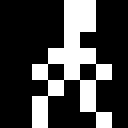
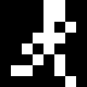
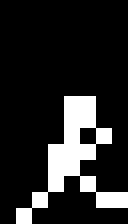
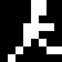
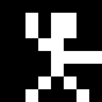
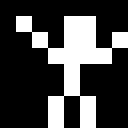
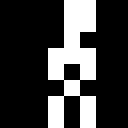
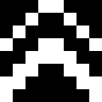
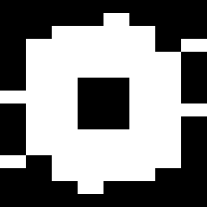
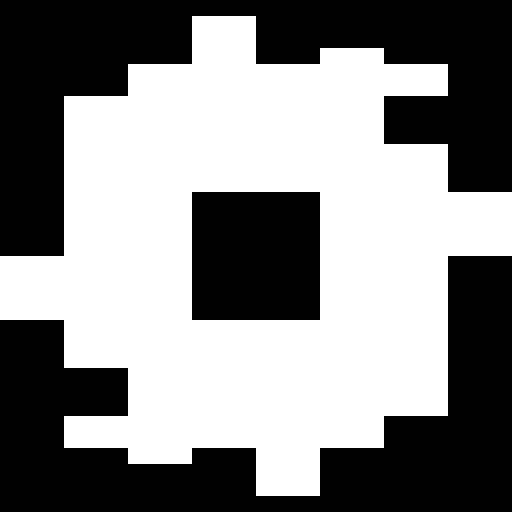

# Player character animations

Every animation for the player character: one 1-colour figure, facing right,
8 pixels wide. Each folder holds the same set of files, all importable from
the Player editor:

| File | Import with |
| --- | --- |
| `<name>.png` + `<name>.json` | **Import from Aseprite** (pick both files) |
| `<prefix>_1.spr` … `<prefix>_N.spr` | **Import animation frames → .spr files** |
| `<prefix>_1.png` … `<prefix>_N.png` | **Import animation frames → images** |
| `<name>.gif`, `preview.png` | Previews only |

Edit a folder's frames in its `generate.py` and re-run it to rebuild every
file there. The shared export code is in `export_sprite.py`.

## All animations in one file

`player-animations.aseprite` holds every animation below in one Aseprite file:
124 frames on one layer, with a coloured tag per animation, named as in the
"Aseprite name" column. `player-animations.png` + `player-animations.json` is
the same thing as an Aseprite sprite sheet: pick both with **Import from
Aseprite** to bring in every animation at once, one per tag. After changing
any animation, re-run its `generate.py` and then `build_aseprite.py` to
rebuild all three.

Props are not in the player's file. Each has its own Aseprite file and sprite
sheet (`trampoline.aseprite`, `double-jump.aseprite`, `saw-blade.aseprite`,
`saw-blade-large.aseprite`, `saw-blade-huge.aseprite`, each with a `.png` +
`.json`), built by the same `build_aseprite.py`. See [Props](#props).

## Overview

| Animation | Folder | Size | Frames | Per frame | Loops | Aseprite name |
| --- | --- | --- | --- | --- | --- | --- |
| Idle | `idle-8x8` | 8×8 | 10 | 67 ms (4) | Yes | `idle` |
| Run cycle | `run-cycle-8x8` | 8×8 | 8 | 50 ms (3) | Yes | `run` |
| Standing jump | `standing-jump-8x8` | 8×8 | 10 | 100 ms (6) | No | `standing-jump` |
| Running jump | `running-jump-8x8` | 8×8 | 8 | 100 ms (6) | No | `running-jump` |
| Cannonball jump | `cannonball-jump-8x8` | 8×8 | 8 | 100 ms (6) | No | `cannonball-jump` |
| Cannonball loop | `cannonball-loop-8x8` | 8×8 | 8 | 100 ms (6) | Yes | `cannonball-loop` |
| Fall start | `fall-start-8x8` | 8×8 | 8 | 100 ms (6) | No | `fall-start` |
| Fall | `fall-8x8` | 8×8 | 12 | 50 ms (3) | Yes | `fall` |
| Hard landing | `hard-landing-8x8` | 8×8 | 10 | 100 ms (6) | No | `hard-landing` |
| Wall bounce | `wall-bounce-8x8` | 8×8 | 8 | 100 ms (6) | No | `wall-bounce` |
| Door opening | `door-open-8x8` | 8×8 | 8 | 100 ms (6) | No | `door-open` |
| Ladder climb | `climb-8x8` | 8×8 | 12 | 50 ms (3) | Yes | `climb` |
| Shrink | `shrink-8x8` | 8×8 | 14 | 67 ms (4) | No | `shrink` |

## Lining the animations up

- **Feet on the bottom row.** Every frame is drawn as if the character were
  standing on the ground, with the feet on the bottom row, so switching
  animations needs no offset.
- **Movement comes from the game.** The animations change only the pose.
  Running forward, the height of a jump, falling and the wall knock-back all
  need the sprite to be moved in game code.
- **Shared frames.** Where one animation hands over to another, they share the
  exact same frame, so the switch doesn't jump:

| From | To | Shared frame |
| --- | --- | --- |
| Run cycle frame 8 | Running jump frame 1 | Toe-off |
| Running jump frame 8 | Run cycle frame 1 (carry on from frame 2) | Landing |
| Run cycle frame 1 | Wall bounce frame 1 | Running in |
| Wall bounce frame 8 | Idle frame 1 | Standing |
| Idle frame 1 | Standing jump frame 1 | Standing |
| Idle frame 1 | Shrink frame 1 | Standing |
| Standing jump frame 10 | Idle frame 1 | Rises into the standing pose |
| Standing jump frames 3, 4 and 9 | Cannonball jump frames 1, 2 and 8 | Crouch, spring, landing |
| Run cycle frame 8 | Fall start frame 1 | Toe-off |
| Fall start frame 8 | Fall frame 1 (carry on from frame 2) | Both arms up, legs apart |
| Hard landing frame 10 | Idle frame 1 | Standing |
| Idle frame 1 | Door opening frame 1 | Standing |
| Door opening frame 8 | Idle frame 1 | Standing |

## Animations

### Idle — `idle-8x8`

Facing right, with the front foot planted ahead of the back one, bouncing
gently up and down with overlapping action. Going down the arms swing out
first, then the back knee softens, the hips drop, the shoulders follow and the
head comes last; at the bottom the arms drop to the sides, then the shoulders
lead back up, the hips rise with the knee still bent, the knee straightens and
the head comes up last. The arms are out the whole way down and at the sides
the whole way up, and both shoulders always move together. Each frame moves
one part by one pixel and no pose repeats.

1. Tall, arms down at the sides
2. Arms swing out as the drop starts
3. Knees soften
4. Knees bend, hips drop, arms out
5. Shoulders follow, arms out
6. Head follows: fully low, arms out
7. Arms drop to the sides as the rise starts
8. Shoulders lead back up
9. Hips rise, knee still bent
10. Knee straightens; the head comes up last as it loops

### Run cycle — `run-cycle-8x8`

The 8 frames cover a single step, from one foot landing to the other. In a
1-colour silhouette both halves of a stride look the same, so this loops as a
full run. The arms swing opposite each other, and the trailing leg folds at
the knee after push-off. The arms are short, and the swing shows at the
shoulders: at full swing each arm sits off its shoulder, and as it passes the
body the shoulder turns in behind the body line, so the arms tuck out of sight
around the passing frame. The shoulders only move forward or back, never up or
down.

1. Landing: front foot reaches the ground, arms at full swing
2. Front knee bends to take the weight, back heel lifts
3. Back heel kicks up behind, bent at the knee
4. Standing leg under the body, back foot tucked up
5. Passing: swinging knee comes through, arms at the sides
6. Standing leg behind the body, swinging knee forward
7. Push off: back leg extends, front knee high
8. Toe-off: front leg reaches out for the next landing

### Standing jump — `standing-jump-8x8`

A jump straight up from standing. Starts on the idle's first frame, bends the
knees and crouches into the idle's low pose, springs up with both arms
swinging up, raises one knee high at the top, lowers it again and lands back
in the idle's low pose, then rises with the knees bent into the idle's
standing pose, so it joins the idle at both ends. In the air the arms are
mirrored either side of the body, like the fall, while one leg stays straight
and the other bends at the hip and knee.

1. Standing, as in the idle
2. Knees bend
3. Crouches low, as in the idle
4. Springs up: legs straighten, arms swing up
5. Leaves the ground: arms high, left leg straight, right leg bent with the foot lifted
6. Right knee comes up: thigh out level, shin hanging from the knee; left leg straight
7. Top of the jump: arms out, right knee still bent up, left leg straight
8. Right leg lowers for the landing
9. Lands low, as in the idle
10. Rising with the knees still bent, back into the idle's standing pose

### Running jump — `running-jump-8x8`

A leap taken mid-run. It takes off from the run cycle's frame 8 and lands on
its frame 1, so switch back to the run at frame 2. The arms are the run's short
arms on fixed shoulders: the front hand stays high through the leap while the
back hand sweeps up behind and back down.

1. Toe-off, as in the run
2. Drive: back leg straight, front knee high, front hand up
3. Rising: back knee folds, back hand swings up
4. Top: front leg reaching forward, both hands high
5. Top: both legs swing forward
6. Legs out in front, hands coming down
7. Front leg reaches for the ground
8. Landing, as in the run

### Cannonball jump — `cannonball-jump-8x8`

A jump from standing that curls into a ball at the top, hugging the knees,
then uncurls to land. Starts on the standing jump's crouch and spring, and
lands on its low landing pose.

1. Crouches low, as in the idle and the standing jump
2. Springs up: legs straighten, arms swing up
3. Knees pulled up, hands reaching for them
4. Cannonball: curled up, hugging the knees
5. Rolling forward in the ball
6. Holding the ball tight
7. Uncurls: legs open out for the landing, arms out
8. Lands low, as in the idle and the standing jump

### Cannonball loop — `cannonball-loop-8x8`

The cannonball jump's curled-up ball rolling forward through a full turn, 45°
a frame, centred so it spins in place. Loop it while the player is in the air,
for example in place of the cannonball jump's frames 4–6.

1. Ball upright, head on top
2. Rolled 45 degrees forward
3. Head facing forward
4. Rolled 135 degrees
5. Upside down
6. Rolled 225 degrees
7. Head facing back
8. Rolled 315 degrees, back to upright next

### Fall start — `fall-start-8x8`

The lead-in to a fall when the player walks or runs off the edge of a
platform. Starts on the run cycle's frame 8 and ends on the fall loop's frame 1.

1. Stepping off: toe-off, as in the run
2. Front foot reaches out over the edge
3. The foot drops into nothing
4. Jolt: arms jerk up, legs come together
5. Arms fully up, legs hang straight
6. Arms settle into the falling flap, legs hang straight
7. Legs start to dangle apart
8. Legs apart, both arms up: the fall loop's first frame

### Fall — `fall-8x8`

A smooth loop for dropping, with the body mirrored: both arms move together
and both legs move together, and the arms are the same two-pixel length as the
legs. The arms flap from up to high above the shoulders, back to up, out level
and down to the hips; the feet kick up, come down, tuck in and go back out. The
arms flap twice as fast as the legs kick: they step every frame, the feet every
third frame. 12 frames at 50 ms make a 0.6 s loop. The game moves the sprite
down. Its first frame is the fall start's last, so after the fall start carry
on from frame 2.

### Hard landing — `hard-landing-8x8`

Landing after a long fall: braces, hits the ground and splats flat out face
down, then pushes up on one arm, gets a knee under and stands. Switch to it
from the fall loop when the player lands after falling a long way; it ends on
the idle's frame 1.

1. Bracing for the ground: legs straight, arms up
2. Impact: knees buckle into a wide squat, arms fling out
3. Splat: flattened out face down on the ground
4. Lying flat
5. Pushes up on one arm
6. Pulls a knee under
7. Up on one knee, hand on the ground
8. Pushes up off the knee
9. Straightening up
10. Standing, as in the idle

### Wall bounce — `wall-bounce-8x8`

Running into a wall just past the right edge and bouncing off it. Starts on
the run cycle's frame 1 and ends on the idle's frame 1. The game should push
the sprite left, mostly over frames 3–5.

1. Running in, as in the run
2. Hit: face and hands flat against the wall
3. Jolt: head snaps back, front arm flung up
4. Knocked back off the feet, legs swinging up in front
5. Lands on the back foot, arms windmilling
6. Staggering, arms out for balance
7. Steadying: bent over, hands on knees
8. Standing again, as in the idle

### Door opening — `door-open-8x8`

Opening a door just past the right edge. The feet stay planted in the idle's
stance the whole time; only the upper body moves. Only the player is
drawn: the game draws the door and swaps it to open around frames 6–7. Starts
and ends on the idle's frame 1.

1. Standing, as in the idle
2. Turns side-on to the door, arms down
3. Reaches out for the handle
4. Grips the handle at the door's edge
5. Turns the handle
6. Leans in and pushes the door
7. Door swings away, hand follows it up
8. Lets go, standing again, as in the idle

### Ladder climb — `climb-8x8`

Climbing a ladder, seen from the front with the arms and legs either side of
the body, like the fall. Made for a steady climb with no pauses: the hands and
the feet take turns on every frame, one hand reaching up as the other pulls
down, then a step of the feet, so something is always moving. As a hand
reaches the rung above, the opposite knee is up at the next one. A full cycle
(both hands, both feet) is 12 frames at 50 ms, 0.6 s. The game moves the
sprite up the ladder.

1. Right knee up
2. Right hand up, left hand down
3. Left knee up, right foot down
4. Right hand up, left hand down
5. Left knee up, right foot down
6. Right hand up, left hand down
7. Left foot down
8. Left hand up, right hand down
9. Left foot down
10. Left hand up, right hand down
11. Right knee up
12. Left hand up, right hand down

### Shrink — `shrink-8x8`

The player shrinking away, for a teleport, a vanish or a death. Starts on the
idle's first frame, swings both arms out and up as the knees bend, crouches
low with the arms up and the feet tucked up off the bottom row, and squeezes
into a solid circle, which squashes wide and stretches tall once, then shrinks
quickly, gives a last thin stretch and bursts into a little spark that flares
and fades. From the circle on, everything is centred in the frame (shapes an
odd number of pixels across sit half a pixel down and to the right). The last
frame is empty.

1. Standing, as in the idle
2. Arms swing out level, legs still straight
3. Arms come up, knees start to bend
4. Crouches low with both arms up, feet tucked up off the bottom row
5. Squeezes into a circle
6. Squashes wide
7. Stretches tall
8. Shrinks
9. Shrinks
10. A last thin stretch
11. A little spark
12. The spark flares
13. The spark fades
14. Gone

## Props

Objects in the level, not the player. Each one has its own folder and its own
Aseprite file, so it imports as a separate sprite.

| Prop | Folder | Size | Frames | Per frame | Loops | Aseprite file |
| --- | --- | --- | --- | --- | --- | --- |
| Trampoline | `trampoline-8x8` | 8×8 | 12 | 50 ms (3) | No | `trampoline.aseprite` (tag `trampoline`) |
| Double jump power-up | `double-jump-8x8` | 8×8 | 12 | 33–100 ms (2–6) | Yes | `double-jump.aseprite` (tag `double-jump`) |
| Saw blade | `saw-blade-8x8` | 8×8 | 4 | 50 ms (3) | Yes | `saw-blade.aseprite` (tag `saw-blade`) |
| Large saw blade | `saw-blade-large-8x16` | 8×16, double wide | 5 | 50 ms (3) | Yes | `saw-blade-large.aseprite` (tag `saw-blade-large`) |
| Huge saw blade | `saw-blade-huge-8x32` | 8×32, quad wide | 12 | 17–33 ms (1–2) | Yes | `saw-blade-huge.aseprite` (tag `saw-blade-huge`) |

The large and huge saw blades are drawn to be shown at double and quad width
(NUSIZ), so they appear 16×16 and 32×32 on screen. Their frame files are still
8 pixels wide; their GIFs and Aseprite files (with a 2:1 or 4:1 pixel ratio)
show them as they will look on the VCS.

### Trampoline — `trampoline-8x8`

A trampoline seen from the side: the bed across the top between two legs with
feet. Only the bed moves. Frame 1 is the trampoline at rest, to show while
nothing is on it; play the animation when the player lands. The bed slams to
its deepest stretch in one frame and flings 2 pixels up past flat on the next,
so the player is launched almost at once: launch them on frame 3. It then
eases back down and settles with a smaller dip and a last flick.

1. Flat at rest, as the player lands
2. Slams to its deepest stretch
3. Flings 2 pixels up past flat (launch the player)
4. Coming back down
5. Almost flat
6. Flat
7. A smaller second dip
8. Bottom of the second dip
9. Coming back up
10. Flat
11. A last small flick up
12. Settled at rest

### Double jump power-up — `double-jump-8x8`

The double jump power-up, two stacked chevrons, spinning on its vertical axis.
It narrows one pixel per frame from 8 wide to 2 (edge on) and widens back out.
Widths of 7, 5 and 3 can't be centred, so on those frames the nearer half is a
pixel wider: the left half on the way in, the right half on the way out. The
back looks the same as the front, so one loop is a full turn, about 0.57 s.
Frame times follow a real spin, lingering face on and passing quickly through
edge on; each frame's time is listed below in ms (NTSC frames).

1. Face on, 8 wide: 100 (6)
2. 7 wide, left edge nearer: 67 (4)
3. 6 wide: 50 (3)
4. 5 wide: 33 (2)
5. 4 wide: 33 (2)
6. 3 wide: 33 (2)
7. Edge on, 2 wide: 33 (2)
8. 3 wide, right edge nearer: 33 (2)
9. 4 wide: 33 (2)
10. 5 wide: 33 (2)
11. 6 wide: 50 (3)
12. 7 wide: 67 (4)

### Saw blade — `saw-blade-8x8`

A circular saw blade spinning clockwise: a round blade with a hole at the hub
and 5 single-pixel teeth sticking out of the rim. The rim has 20 pixel
positions around it and the teeth sit every 4th one, so each frame moves every
tooth one position clockwise and after 4 frames it looks the same again.

1. 5 teeth around the rim
2. Teeth one step clockwise
3. Two steps
4. Three steps; the next step is frame 1 again

### Large saw blade — `saw-blade-large-8x16`

The same idea at double width and 16 rows tall: a round blade with a hole at
the hub and 8 single-pixel teeth on a rim of 40 positions, every 5th one. Each
frame moves every tooth one position clockwise, so after 5 frames it looks the
same again.

1. 8 teeth around the rim
2. Teeth one step clockwise
3. Two steps
4. Three steps
5. Four steps; the next step is frame 1 again

### Huge saw blade — `saw-blade-huge-8x32`

The biggest blade, at quad width and 32 rows tall, with 8 hooked teeth that
ramp out and drop sharply, cutting edge first in the direction of the spin.
Each frame turns it 3.75 degrees clockwise, which moves the teeth on the sides
about one row, so after 12 frames (45 degrees, one tooth) it looks the same
again. The frames run 33, 33 and 17 ms (2, 2, 1 NTSC frames) in turn, so a
tooth passes every third of a second.

1. 8 hooked teeth
2. Turned 3.75 degrees clockwise
3. 7.5 degrees
4. 11.25 degrees
5. 15 degrees
6. 18.75 degrees
7. 22.5 degrees
8. 26.25 degrees
9. 30 degrees
10. 33.75 degrees
11. 37.5 degrees
12. 41.25 degrees; another 3.75 is frame 1 again
