# Player character animations

Every animation for the player character, one 1-colour figure facing right,
8 pixels wide, plus the props in the level. The player's animations are in
`player/`, one folder each; every prop has its own folder. Each folder holds
the same set of files, all importable from the Player editor:

| File | Import with |
| --- | --- |
| `<name>.png` + `<name>.json` | **Import from Aseprite** (pick both files) |
| `<prefix>_1.spr` … `<prefix>_N.spr` | **Import animation frames → .spr files** |
| `<prefix>_1.png` … `<prefix>_N.png` | **Import animation frames → images** |
| `<name>.gif`, `preview.png` | Previews only |

Edit a folder's frames in its `generate.py` and re-run it to rebuild every
file there. The shared export code is in `export_sprite.py`, next to
`build_aseprite.py`, which builds the Aseprite files.

## All animations in one file

`player/player-animations.aseprite` holds every player animation below in one
Aseprite file: 204 frames on one layer, with a coloured tag per animation,
named as in the "Aseprite name" column. `player/player-animations.png` +
`.json` beside it is the same thing as an Aseprite sprite sheet: pick both with
**Import from Aseprite** to bring in every animation at once, one per tag. After changing
any animation, re-run its `generate.py` and then `build_aseprite.py` to
rebuild all three.

Props are not in the player's file. Each lives in its own folder, with its
own Aseprite file next to its sprite sheet, built by the same
`build_aseprite.py`. See [Props](#props).

## Overview

| Animation | Folder | Size | Frames | Per frame | Loops | Aseprite name |
| --- | --- | --- | --- | --- | --- | --- |
| Idle | `player/idle-8x8` | 8×8 | 10 | 67 ms (4) | Yes | `idle` |
| Run | `player/run-cycle-8x8` | 8×8 | 8 | 50 ms (3) | Yes | `run` |
| Standing jump | `player/standing-jump-8x8` | 8×8 | 10 | 100 ms (6) | No | `standing-jump` |
| Running jump | `player/running-jump-8x8` | 8×8 | 8 | 100 ms (6) | No | `running-jump` |
| Cannonball jump | `player/cannonball-jump-8x8` | 8×8 | 8 | 100 ms (6) | No | `cannonball-jump` |
| Cannonball loop | `player/cannonball-loop-8x8` | 8×8 | 8 | 67 ms (4) | Yes | `cannonball-loop` |
| Fall start | `player/fall-start-8x8` | 8×8 | 8 | 50 ms (3) | No | `fall-start` |
| Fall | `player/fall-8x8` | 8×8 | 12 | 50 ms (3) | Yes | `fall` |
| Hard landing | `player/hard-landing-8x8` | 8×8 | 10 | 100 ms (6) | No | `hard-landing` |
| Wall bounce | `player/wall-bounce-8x8` | 8×8 | 8 | 100 ms (6) | No | `wall-bounce` |
| Door opening | `player/door-open-8x8` | 8×8 | 8 | 100 ms (6) | No | `door-open` |
| Climb | `player/climb-8x8` | 8×8 | 12 | 50 ms (3) | Yes | `climb` |
| Shrink | `player/shrink-8x8` | 8×8 | 14 | 67 ms (4) | No | `shrink` |
| Disintegrate | `player/disintegrate-8x8` | 8×8 | 15 | 33 ms (2) | No | `disintegrate` |
| Pikes | `player/pikes-hit-8x8` | 8×8 | 21 | 33–300 ms (2–18) | No | `pikes-hit` |
| Blow up | `player/blow-up-8x8` | 8×8 | 17 | 33–67 ms (2–4) | No | `blow-up` |
| Crouch | `player/crouch-8x8` | 8×8 | 4 | 50 ms (3) | No | `crouch` |
| Slide | `player/slide-8x8` | 8×8 | 4 | 50–100 ms (3–6) | Frames 3–4 | `slide` |
| Ledge climb | `player/ledge-climb-8x8` | 8×8 | 10 | 50–100 ms (3–6) | No | `ledge-climb` |
| Fist pump | `player/fist-pump-8x8` | 8×8 | 9 | 67–300 ms (4–18) | No | `fist-pump` |

## Lining the animations up

- **Feet on the bottom row.** Every frame is drawn as if the character were
  standing on the ground, with the feet on the bottom row, so switching
  animations needs no offset.
- **Movement comes from the game.** The animations change only the pose.
  Running forward, the height of a jump, falling and the wall knock-back all
  need the sprite to be moved in game code.
- **Shared frames.** Where one animation hands over to another, they share the
  exact same frame, so the switch doesn't jump:

| From | To | Shared frame |
| --- | --- | --- |
| Run frame 8 | Running jump frame 1 | Toe-off |
| Running jump frame 8 | Run frame 1 (carry on from frame 2) | Landing |
| Run frame 1 | Wall bounce frame 1 | Running in |
| Wall bounce frame 8 | Idle frame 1 | Standing |
| Idle frame 1 | Standing jump frame 1 | Standing |
| Idle frame 1 | Shrink frame 1 | Standing |
| Idle frame 1 | Disintegrate frame 1 | Standing |
| Idle frame 1 | Blow up frame 1 | Standing |
| Idle frames 1 and 7 | Crouch frames 1 and 2 | Standing, knees bent |
| Fall frame 1 | Pikes frame 1 | Arms up, feet out |
| Standing jump frame 10 | Idle frame 1 | Rises into the standing pose |
| Standing jump frames 3, 4 and 9 | Cannonball jump frames 1, 2 and 8 | Crouch, spring, landing |
| Run frame 8 | Fall start frame 1 | Toe-off |
| Run frame 1 | Slide frame 1 | Running in |
| Ledge climb frame 10 | Idle frame 1 | Standing |
| Idle frame 1 | Fist pump frame 1 | Standing |
| Fist pump frame 9 | Idle frame 1 | Rises into the standing pose |
| Fall start frame 8 | Fall frame 1 (carry on from frame 2) | Both arms up, legs apart |
| Hard landing frame 10 | Idle frame 1 | Standing |
| Idle frame 1 | Door opening frame 1 | Standing |
| Door opening frame 8 | Idle frame 1 | Standing |

## Animations

### Idle — `idle-8x8`

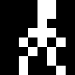

Facing right, with the front foot planted ahead of the back one, bouncing
gently up and down with overlapping action. Going down the arms swing out
first, then the back knee softens, the hips drop, the shoulders follow and the
head comes last; at the bottom the arms drop to the sides, then the shoulders
lead back up, the hips rise with the knee still bent, the knee straightens and
the head comes up last. The arms are out the whole way down and at the sides
the whole way up, and both shoulders always move together. Each frame moves
one part by one pixel and no pose repeats.

1. Tall, arms down at the sides
2. Arms swing out as the drop starts
3. Knees soften
4. Knees bend, hips drop, arms out
5. Shoulders follow, arms out
6. Head follows: fully low, arms out
7. Arms drop to the sides as the rise starts
8. Shoulders lead back up
9. Hips rise, knee still bent
10. Knee straightens; the head comes up last as it loops

### Run — `run-cycle-8x8`

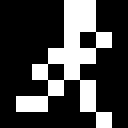

The 8 frames cover a single step, from one foot landing to the other. In a
1-colour silhouette both halves of a stride look the same, so this loops as a
full run. The arms swing opposite each other, and the trailing leg folds at
the knee after push-off. The arms are short, and the swing shows at the
shoulders: at full swing each arm sits off its shoulder, and as it passes the
body the shoulder turns in behind the body line, so the arms tuck out of sight
around the passing frame. The shoulders only move forward or back, never up or
down.

1. Landing: front foot reaches the ground, arms at full swing
2. Front knee bends to take the weight, back heel lifts
3. Back heel kicks up behind, bent at the knee
4. Standing leg under the body, back foot tucked up
5. Passing: swinging knee comes through, arms at the sides
6. Standing leg behind the body, swinging knee forward
7. Push off: back leg extends, front knee high
8. Toe-off: front leg reaches out for the next landing

### Standing jump — `standing-jump-8x8`

A jump straight up from standing. Starts on the idle's first frame, bends the
knees and crouches into the idle's low pose, springs up with both arms
swinging up, raises one knee high at the top, lowers it again and lands back
in the idle's low pose, then rises with the knees bent into the idle's
standing pose, so it joins the idle at both ends. In the air the arms are
mirrored either side of the body, like the fall, while one leg stays straight
and the other bends at the hip and knee.

1. Standing, as in the idle
2. Knees bend
3. Crouches low, as in the idle
4. Springs up: legs straighten, arms swing up
5. Leaves the ground: arms high, left leg straight, right leg bent with the foot lifted
6. Right knee comes up: thigh out level, shin hanging from the knee; left leg straight
7. Top of the jump: arms out, right knee still bent up, left leg straight
8. Right leg lowers for the landing
9. Lands low, as in the idle
10. Rising with the knees still bent, back into the idle's standing pose

### Running jump — `running-jump-8x8`

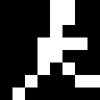

A leap taken mid-run. It takes off from the run's frame 8 and lands on
its frame 1, so switch back to the run at frame 2. The arms are the run's short
arms on fixed shoulders: the front hand stays high through the leap while the
back hand sweeps up behind and back down.

1. Toe-off, as in the run
2. Drive: back leg straight, front knee high, front hand up
3. Rising: back knee folds, back hand swings up
4. Top: front leg reaching forward, both hands high
5. Top: both legs swing forward
6. Legs out in front, hands coming down
7. Front leg reaches for the ground
8. Landing, as in the run

### Cannonball jump — `cannonball-jump-8x8`

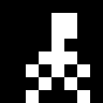

A jump from standing that curls into a ball at the top, hugging the knees,
then uncurls to land. Starts on the standing jump's crouch and spring, and
lands on its low landing pose.

1. Crouches low, as in the idle and the standing jump
2. Springs up: legs straighten, arms swing up
3. Knees pulled up, hands reaching for them
4. Cannonball: curled up, hugging the knees
5. Rolling forward in the ball
6. Holding the ball tight
7. Uncurls: legs open out for the landing, arms out
8. Lands low, as in the idle and the standing jump

### Cannonball loop — `cannonball-loop-8x8`

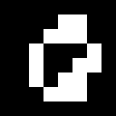

The cannonball jump's curled-up ball rolling forward through a full turn, 45°
a frame, centred so it spins in place. Loop it while the player is in the air,
for example in place of the cannonball jump's frames 4–6.

1. Ball upright, head on top
2. Rolled 45 degrees forward
3. Head facing forward
4. Rolled 135 degrees
5. Upside down
6. Rolled 225 degrees
7. Head facing back
8. Rolled 315 degrees, back to upright next

### Fall start — `fall-start-8x8`

The lead-in to a fall when the player walks or runs off the edge of a
platform. Starts on the run's frame 8 and ends on the fall loop's frame 1.

1. Stepping off: toe-off, as in the run
2. Front foot reaches out over the edge
3. The foot drops into nothing
4. Jolt: arms jerk up, legs come together
5. Arms fully up, legs hang straight
6. Arms settle into the falling flap, legs hang straight
7. Legs start to dangle apart
8. Legs apart, both arms up: the fall loop's first frame

### Fall — `fall-8x8`

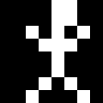

A smooth loop for dropping, with the body mirrored: both arms move together
and both legs move together, and the arms are the same two-pixel length as the
legs. The arms flap from up to high above the shoulders, back to up, out level
and down to the hips; the feet kick up, come down, tuck in and go back out. The
arms flap twice as fast as the legs kick: they step every frame, the feet every
third frame. 12 frames at 50 ms make a 0.6 s loop. The game moves the sprite
down. Its first frame is the fall start's last, so after the fall start carry
on from frame 2.

### Hard landing — `hard-landing-8x8`

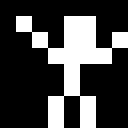

Landing after a long fall: braces, hits the ground and splats flat out face
down, then pushes up on one arm, gets a knee under and stands. Switch to it
from the fall loop when the player lands after falling a long way; it ends on
the idle's frame 1.

1. Bracing for the ground: legs straight, arms up
2. Impact: knees buckle into a wide squat, arms fling out
3. Splat: flattened out face down on the ground
4. Lying flat
5. Pushes up on one arm
6. Pulls a knee under
7. Up on one knee, hand on the ground
8. Pushes up off the knee
9. Straightening up
10. Standing, as in the idle

### Wall bounce — `wall-bounce-8x8`

Running into a wall just past the right edge and bouncing off it. Starts on
the run's frame 1 and ends on the idle's frame 1. The game should push
the sprite left, mostly over frames 3–5.

1. Running in, as in the run
2. Hit: face and hands flat against the wall
3. Jolt: head snaps back, front arm flung up
4. Knocked back off the feet, legs swinging up in front
5. Lands on the back foot, arms windmilling
6. Staggering, arms out for balance
7. Steadying: bent over, hands on knees
8. Standing again, as in the idle

### Door opening — `door-open-8x8`

Opening a door just past the right edge. The feet stay planted in the idle's
stance the whole time; only the upper body moves. Only the player is
drawn: the game draws the door and swaps it to open around frames 6–7. Starts
and ends on the idle's frame 1.

1. Standing, as in the idle
2. Turns side-on to the door, arms down
3. Reaches out for the handle
4. Grips the handle at the door's edge
5. Turns the handle
6. Leans in and pushes the door
7. Door swings away, hand follows it up
8. Lets go, standing again, as in the idle

### Climb — `climb-8x8`

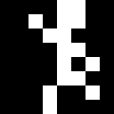

Climbing a ladder, seen from the front with the arms and legs either side of
the body, like the fall. Made for a steady climb with no pauses: the hands and
the feet take turns on every frame, one hand reaching up as the other pulls
down, then a step of the feet, so something is always moving. As a hand
reaches the rung above, the opposite knee is up at the next one. A full cycle
(both hands, both feet) is 12 frames at 50 ms, 0.6 s. The game moves the
sprite up the ladder.

1. Right knee up
2. Right hand up, left hand down
3. Left knee up, right foot down
4. Right hand up, left hand down
5. Left knee up, right foot down
6. Right hand up, left hand down
7. Left foot down
8. Left hand up, right hand down
9. Left foot down
10. Left hand up, right hand down
11. Right knee up
12. Left hand up, right hand down

### Shrink — `shrink-8x8`

The player shrinking away, for a teleport, a vanish or a death. Starts on the
idle's first frame, swings both arms out and up as the knees bend, crouches
low with the arms up and the feet tucked up off the bottom row, and squeezes
into a solid circle, which squashes wide and stretches tall once, then shrinks
quickly, gives a last thin stretch and bursts into a little spark that flares
and fades. From the circle on, everything is centred in the frame (shapes an
odd number of pixels across sit half a pixel down and to the right). The last
frame is empty.

1. Standing, as in the idle
2. Arms swing out level, legs still straight
3. Arms come up, knees start to bend
4. Crouches low with both arms up, feet tucked up off the bottom row
5. Squeezes into a circle
6. Squashes wide
7. Stretches tall
8. Shrinks
9. Shrinks
10. A last thin stretch
11. A little spark
12. The spark flares
13. The spark fades
14. Gone

### Disintegrate — `disintegrate-8x8`

The player turning to ash and crumbling into a pile, for a death. Starts on the
idle's first frame. Like a cartoon, the body stays exactly where it is while it
crumbles from the bottom up, two grains a frame: everything above keeps hanging
in place until the ash beneath it has gone, and the head drops last. Ash falls
a row a frame and slides outward down the pile; where there's no room it packs
into the ash below, so it ends on a small mound 6 pixels wide on the bottom
row. No grain moves more than one pixel a frame.

1. Standing, as in the idle
2. The feet crumble to ash
3. The shins crumble; the rest stays standing
4. The knees go
5. The hips go, the body still hanging in place
6. The arms crumble away
7. The chest goes
8. The neck goes
9. The head is left hanging, then drops
10. Falling
11. Falling
12. The head lands
13. The last ash slides down
14. Packing down
15. Settled into a pile of ash

### Pikes — `pikes-hit-8x8`

The player falling onto pikes and getting stuck on them, for a death. Starts on
the fall loop's first frame. On impact the body folds over the pikes at the
hips, head and feet flung up, bounces once off the tips and drops back, then
sags and hangs limp, draped face down across them with an arm and the legs
dangling. The arm swings like a pendulum, right forward and right back, then in
smaller swings dying away; the legs twitch, a foot flicks, and it goes still.
It's the player sprite only: draw it over the pikes sprite, which shows
through where they cross.

### Blow up — `blow-up-8x8`

The player blowing up, for a death. Starts on the idle's first frame. A jolt
flings the arms and legs out, then the body bursts into a round blast. Ten
pieces fly out of it, the top ones thrown up and out and the rest out to the
sides, each under a pixel a frame and falling as it goes, while a puff of smoke
in the middle shrinks away. The pieces arc off the edges one by one and it ends
empty.

### Crouch — `crouch-8x8`

The player crouching down to duck, a row lower each frame: from the idle's first
frame through its lowest pose (frame 7), sinking with the arms out for balance,
to a duck two rows shorter than standing. Ducked, the head and neck still sit
clear of the hunched shoulders and the two bent legs stay apart, so it still
reads as the player. Play it once and hold the last frame while ducking; play
it backwards to stand up.

1. Standing, as in the idle
2. Knees bend, as in the idle's low point
3. Sinking lower, arms out for balance, knees out
4. Ducked: hunched over, arms in, knees bent right up

### Slide — `slide-8x8`

The player dropping into a slide along the ground, like Mega Man's slide.
Starts on the run's first frame, drops with the legs kicking apart, then slides
two rows shorter than standing: low, the arms out for balance, both legs
splayed and visible, the back one stretched out behind and the front one out in
front. Loop frames 3 and 4 for as long as the player slides, and move the
sprite in game code.

1. Running in, as in the run's frame 1 (3 NTSC frames)
2. Dropping: legs kicking apart (3)
3. Sliding: low, arms out, back leg behind, front leg in front (6)
4. Sliding: the back leg stretches further out, the foot dragging on the ground (6)

### Ledge climb — `ledge-climb-8x8`

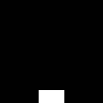

The player climbing up over a ledge, all inside one 8x8 block: the sprite sits
on top of the ledge and never moves, with the ledge's top corner 2 pixels in
from the left of its bottom edge. The player starts hanging below the sprite
with only the hands showing on top, pulls up into view head first, pushes the
chest over the edge, gets the front knee up and swings the back leg over, then
stands up through the crouch played backwards, ending on the idle's first
frame. Play it once.

1. Hands grab the top of the ledge; the rest of the player is below the sprite
2. Pulls up, the head comes into view beside the hands
3. Chin over the edge, forearms flat on top
4. Chest over the edge, arms straight, pushing down
5. Front knee up onto the ledge, back leg still over the edge
6. Crouched on top, the back leg swinging up
7. Ducked, as in the crouch's frame 4
8. Rising, as in the crouch's frame 3
9. Knees bent, as in the crouch's frame 2
10. Standing, as in the idle

### Fist pump — `fist-pump-8x8`

The player celebrating like Mario: a hop with one fist punched up in the air.
Starts on the idle's first frame, crouches, springs up swinging the front fist
up past the head, and hangs at the top (0.3 s) with the fist high, the other
fist in at the chest and the back knee raised. Comes down with the fist still
up, lands low, drops the arm and rises with the knees bent into the idle's first
frame. Play it once; the pose is drawn in place, and the game can move the
sprite up and down for the hop.

1. Standing, as in the idle
2. Knees bend
3. Crouches low
4. Springs up, the front fist swinging up past the head
5. Top of the hop: fist high, other fist at the chest, back knee up (held)
6. Coming down, fist still up
7. Lands low, fist still up
8. The arm drops
9. Rising with the knees bent

## Props

Objects in the level, not the player. Each one is self-contained in its own
folder: the frames in every format listed at the top, plus its own Aseprite
file, so it imports as a separate sprite. The folder's `<folder>.png` +
`<folder>.json` is its sprite sheet for **Import from Aseprite**.

| Prop | Folder | Size | Frames | Per frame | Loops | Aseprite file (in the folder) |
| --- | --- | --- | --- | --- | --- | --- |
| Trampoline | `trampoline-8x8` | 8×8 | 12 | 50 ms (3) | No | `trampoline.aseprite` (tag `trampoline`) |
| Double jump power-up | `double-jump-8x8` | 8×8 | 12 | 33–100 ms (2–6) | Yes | `double-jump.aseprite` (tag `double-jump`) |
| Saw blade | `saw-blade-8x8` | 8×8 | 4 | 50 ms (3) | Yes | `saw-blade.aseprite` (tag `saw-blade`) |
| Large saw blade | `saw-blade-large-8x16` | 8×16, double wide | 5 | 50 ms (3) | Yes | `saw-blade-large.aseprite` (tag `saw-blade-large`) |
| Huge saw blade | `saw-blade-huge-8x32` | 8×32, quad wide | 12 | 17–33 ms (1–2) | Yes | `saw-blade-huge.aseprite` (tag `saw-blade-huge`) |
| Fire | `fire-8x16` | 8×16 | 24 | 33 ms (2) | Yes | `fire.aseprite` (tag `fire`) |
| Large fire | `fire-large-8x24` | 8×24, double wide | 24 | 33 ms (2) | Yes | `fire-large.aseprite` (tag `fire-large`) |
| Key | `key-8x6` | 8×6 | 28 | 17–100 ms (1–6) | Yes | `key.aseprite` (tag `key`) |
| Extra life | `life-8x8` | 8×8 | 14 | 17–83 ms (1–5) | Yes | `life.aseprite` (tag `life`) |
| Spinning circle | `coin-8x8` | 8×8 | 10 | 33–133 ms (2–8) | Yes | `coin.aseprite` (tag `coin`) |
| Speed | `speed-8x8` | 8×8 | 8 | 50 ms (3) | Yes | `speed.aseprite` (tag `speed`) |
| Pikes | `pikes-8x8` | 8×8 | 5 | 33–500 ms (2–30) | No | `pikes.aseprite` (tag `pikes`) |
| Vortex | `vortex-8x8` | 8×8 | 12 | 50 ms (3) | Yes | `vortex.aseprite` (tag `vortex`) |
| Fireball | `fireball-8x16` | 8×16 | 24 | 33 ms (2) | Yes | `fireball.aseprite` (tag `fireball`) |
| Large vortex | `vortex-large-8x16` | 8×16, double wide | 12 | 50 ms (3) | Yes | `vortex-large.aseprite` (tag `vortex-large`) |
| Flamethrower | `flamethrower/` | 8×12, quad wide | 12 + 4 + 8 + 10 | 33–67 ms (2–4) | Idle and loop | `flamethrower.aseprite` (tags `flamethrower-idle`, `-start`, `-loop`, `-end`) |

The large and huge saw blades, the large fire, the large vortex, the
flamethrower and the bigger explosions are drawn to be shown at double or quad
width (NUSIZ). Their frame files are still 8 pixels wide; their GIFs and Aseprite files (with a 2:1 or 4:1 pixel ratio)
show them as they will look on the VCS.

### Trampoline — `trampoline-8x8`

A trampoline seen from the side: the bed across the top between two legs with
feet. Only the bed moves. Frame 1 is the trampoline at rest, to show while
nothing is on it; play the animation when the player lands. The bed slams to
its deepest stretch in one frame and flings 2 pixels up past flat on the next,
so the player is launched almost at once: launch them on frame 3. It then
eases back down and settles with a smaller dip and a last flick.

1. Flat at rest, as the player lands
2. Slams to its deepest stretch
3. Flings 2 pixels up past flat (launch the player)
4. Coming back down
5. Almost flat
6. Flat
7. A smaller second dip
8. Bottom of the second dip
9. Coming back up
10. Flat
11. A last small flick up
12. Settled at rest

### Double jump power-up — `double-jump-8x8`

The double jump power-up, two stacked chevrons, spinning on its vertical axis.
It narrows one pixel per frame from 8 wide to 2 (edge on) and widens back out.
Widths of 7, 5 and 3 can't be centred, so on those frames the nearer half is a
pixel wider: the left half on the way in, the right half on the way out. The
back looks the same as the front, so one loop is a full turn, about 0.57 s.
Frame times follow a real spin, lingering face on and passing quickly through
edge on; each frame's time is listed below in ms (NTSC frames).

1. Face on, 8 wide: 100 (6)
2. 7 wide, left edge nearer: 67 (4)
3. 6 wide: 50 (3)
4. 5 wide: 33 (2)
5. 4 wide: 33 (2)
6. 3 wide: 33 (2)
7. Edge on, 2 wide: 33 (2)
8. 3 wide, right edge nearer: 33 (2)
9. 4 wide: 33 (2)
10. 5 wide: 33 (2)
11. 6 wide: 50 (3)
12. 7 wide: 67 (4)

### Saw blade — `saw-blade-8x8`

A circular saw blade spinning clockwise: a round blade with a hole at the hub
and 5 single-pixel teeth sticking out of the rim. The rim has 20 pixel
positions around it and the teeth sit every 4th one, so each frame moves every
tooth one position clockwise and after 4 frames it looks the same again.

1. 5 teeth around the rim
2. Teeth one step clockwise
3. Two steps
4. Three steps; the next step is frame 1 again

### Large saw blade — `saw-blade-large-8x16`

The same idea at double width and 16 rows tall: a round blade with a hole at
the hub and 8 single-pixel teeth on a rim of 40 positions, every 5th one. Each
frame moves every tooth one position clockwise, so after 5 frames it looks the
same again.

1. 8 teeth around the rim
2. Teeth one step clockwise
3. Two steps
4. Three steps
5. Four steps; the next step is frame 1 again

### Huge saw blade — `saw-blade-huge-8x32`

The biggest blade, at quad width and 32 rows tall, with 8 hooked teeth that
ramp out and drop sharply, cutting edge first in the direction of the spin, and
a ring of 8 slots around the hub that turns with it, so the spin shows in the
middle of the blade as well as at the rim.
Each frame turns it 3.75 degrees clockwise, which moves the teeth on the sides
about one row, so after 12 frames (45 degrees, one tooth) it looks the same
again. The frames run 17, 17 and 33 ms (1, 1, 2 NTSC frames) in turn, so a
tooth passes every quarter of a second.

1. 8 hooked teeth
2. Turned 3.75 degrees clockwise
3. 7.5 degrees
4. 11.25 degrees
5. 15 degrees
6. 18.75 degrees
7. 22.5 degrees
8. 26.25 degrees
9. 30 degrees
10. 33.75 degrees
11. 37.5 degrees
12. 41.25 degrees; another 3.75 is frame 1 again

### Fire — `fire-8x16`

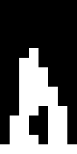

A roaring fire 8 pixels wide and 16 tall, burning on the bottom row, looping.
Three tongues of flame, a tall one in the middle and a shorter one either side,
leap up and die back by several rows (the middle one from about 6 rows to the
full 16) and whip their tips side to side, out of time with each other, with
quicker wobbles on top, so it flickers fast but flows from frame to frame.
Whenever a tongue peaks its tip breaks off and rises as a separate lick that
shrinks away. The outline slopes steeply down from the middle, and the bottom
row is a steady base clear of the outermost columns, so the fire tapers to its
edges instead of ending in a hard edge 8 pixels across. A hollow core near the
base keeps it reading as fire in one colour. Six sparks rise out of the flame
in turn, a row a frame, drifting a pixel side to side, and each burns out at its
own height, so the top of the sprite isn't marked by a line where they all
stop. All 24 frames are different, and frame 24 leads straight back into frame
1.

### Large fire — `fire-large-8x24`

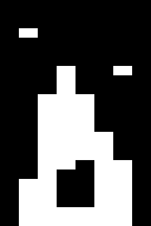

The fire above, stretched to 24 rows and shown at double width, so on screen
it's 16 wide and 24 tall. Same roaring tongues, breaking-off licks, tapered
sides, steady base and hollow core. Its six sparks rise a row a frame and step
just once to the side on the way up (the pixels are double wide, so more drift
than that looks jittery), each burning out at its own height. 24 frames, all
different, looping.

### Key — `key-8x6`

A key (bow on the left, teeth hanging from the blade) spinning on its vertical
axis through a full turn. It narrows a pixel a frame from 8 wide to edge on,
widens out to its back (mirrored, bow on the right), narrows again and widens
back to the front; on odd widths the nearer half is a pixel wider. Frame times
follow a real spin, lingering face on and slipping quickly through the narrow
widths, and match the double jump power-up's speed: half a turn in 34 NTSC
frames, a full turn in about 1.1 s. Frame 1 is the key face on.

### Extra life — `life-8x8`

A solid square spinning clockwise in place, inside the 8×8 area, with a quick
pulse: full size for most of the turn, it shrinks to a 4×4 square and springs
back each time it comes upright. Each frame is the square at its angle and size,
drawn from one edge turned about the centre and filled in, so it stays exactly
symmetrical. A square looks the same every quarter turn, so the loop is 90° of
the spin and one pulse, a quarter turn every 0.4 s.

### Spinning circle — `coin-8x8`

A solid circle 6 pixels across, like a coin, centred in the 8×8 and spinning on
its vertical axis: it narrows a pixel a frame to edge on and widens back, leaning
half a pixel to the nearer side on odd widths. A circle looks the same from
behind, so the 10 frames are half a turn, at the double jump power-up's speed.

### Speed — `speed-8x8`

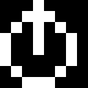

A speed boost: a stopwatch, a round face with the button on top, its hand
sweeping round fast, an eighth of a turn a frame, so it goes all the way round
in 0.4 s.

### Pikes — `pikes-8x8`

A pike trap. Frame 1 shows just the tips above the ground and is held for half a
second as a warning; then four pikes, each one pixel thick with a clear column
between them, burst out fast, middle first: a tall one straight up to the top
row, one either side leaning outward and a short one at the right edge. It ends
with them all out; play it backwards to pull them in.

### Vortex — `vortex-8x8` and `vortex-large-8x16`

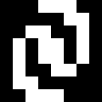 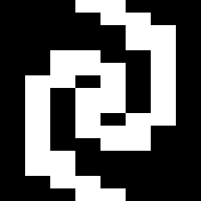

A swirling vortex hazard: two spiral arms winding in to a solid eye inside a
round area, turning a little each frame so it draws everything in. Two arms look
the same every half turn, so each is 12 frames of half a turn, looping. The
large one is double wide, 16×16 on screen, and its arms wind further round.

### Fireball — `fireball-8x16`

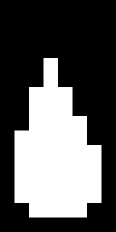

A fireball burning like a torch: a round, simmering ball of fire in the bottom
half with flames rising straight up off it. Three tongues of flame, the middle
one tallest, rise and fall and sway out of time with each other, and when one
peaks a spark flies off its tip and drifts straight up, lit on every frame of
its life so it doesn't flicker. Everything
moves a pixel or less a frame, so it flows: 24 frames at 33 ms, looping.

### Flamethrower — `flamethrower/`

A jet of flame shooting right from a nozzle at the left edge, quad wide so it's
32 pixels long on screen, widening into a billowing head that rounds off inside
the 8 columns, with ragged edges and a hollow streak. Four animations in one
Aseprite file, each in its own folder inside `flamethrower/`:

- `flamethrower-idle`: the pilot light, a tiny flame flickering at the nozzle
  with little sparks floating up off it, 12 frames looping.
- `flamethrower-start`: the flame bursts out and reaches across in 4 frames,
  leading into the loop.
- `flamethrower-loop`: the full jet, streaming out a column a frame and
  throwing off sparks, 8 frames looping.
- `flamethrower-end`: the nozzle cuts out, the flame tears away and lifts,
  throwing up a shower of 17 sparks that burn out at different heights, 10
  frames, ending empty.

## Visual effects

Effects with no part in the game's rules, each in its own folder with its own
Aseprite file like the props.

| Effect | Folder | Size | Frames | Per frame | Loops | Aseprite file (in the folder) |
| --- | --- | --- | --- | --- | --- | --- |
| Small explosion | `explosion-small-8x8` | 8×8 | 11 | 50–67 ms (3–4) | No | `explosion-small.aseprite` (tag `explosion-small`) |
| Explosion | `explosion-8x16` | 8×16, double wide | 14 | 50–67 ms (3–4) | No | `explosion.aseprite` (tag `explosion`) |
| Large explosion | `explosion-large-8x32` | 8×32, quad wide | 23 | 50–67 ms (3–4) | No | `explosion-large.aseprite` (tag `explosion-large`) |
| Spark | `spark-8x8` | 8×8 | 15 | 17–33 ms (1–2) | No | `spark.aseprite` (tag `spark`) |

### Explosions

 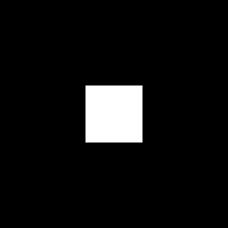 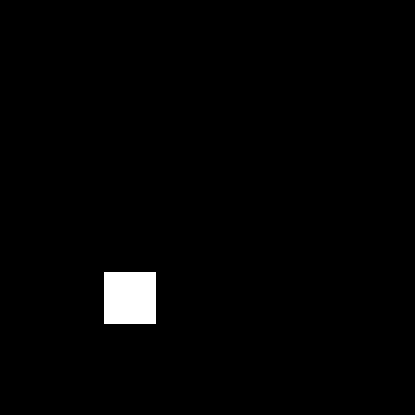

The small (8×8) and regular (16×16 on screen) explosions are the same blast: a
flash bursts into a ragged, churning fireball that fills the area and its middle
blows clear; as it does, puffs of smoke billow out of it, swell and drift up,
shrinking away, while the fire under them crumbles away pixel by pixel, ending
empty. The large one (32×32 on screen) is a chain explosion instead: four
smaller blasts go off one after another around the area, then the biggest goes
off in the middle and swallows them; at its biggest, puffs of smoke billow out
of its ring and drift up as the fire crumbles away under them.

### Spark — `spark-8x8`

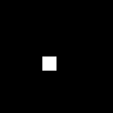

A spark: a hot point a little off the middle crackles out into six uneven rays,
each at its own angle and speed, so it never looks regular. Gravity pulls on
them: the rays droop at their far ends as they grow, and once they break off
from the middle they fall faster and faster as they fly, the short ones burning
out first, ending empty. 15 frames of 17 and 33 ms in turn (about 0.37 s in
all), moving about half a pixel a frame.
