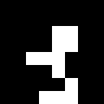

# Player character animations

Every animation for the player character: one 1-colour figure, facing right,
8 pixels wide. Each folder holds the same set of files, all importable from
the Player editor:

| File | Import with |
| --- | --- |
| `<name>.png` + `<name>.json` | **Import from Aseprite** (pick both files) |
| `<prefix>_1.spr` … `<prefix>_N.spr` | **Import animation frames → .spr files** |
| `<prefix>_1.png` … `<prefix>_N.png` | **Import animation frames → images** |
| `<name>.gif`, `preview.png` | Previews only |

Edit a folder's frames in its `generate.py` and re-run it to rebuild every
file there. The shared export code is in `export_sprite.py`.

## Overview

| Animation | Folder | Size | Frames | Per frame | Loops | Aseprite name |
| --- | --- | --- | --- | --- | --- | --- |
| Idle | `idle-8x8` | 8×8 | 8 | 250 ms (15 NTSC frames) | Yes | `idle` |
| Run cycle | `run-cycle-8x8` | 8×8 | 8 | 100 ms (6) | Yes | `run` |
| Standing jump | `standing-jump-8x16` | 8×16 | 8 | 100 ms (6) | No | `standing-jump` |
| Running jump | `running-jump-8x16` | 8×16 | 8 | 100 ms (6) | No | `running-jump` |
| Fall | `fall-8x8` | 8×8 | 4 | 100 ms (6) | Yes | `fall` |
| Wall bounce | `wall-bounce-8x8` | 8×8 | 8 | 100 ms (6) | No | `wall-bounce` |
| Jump (pose only) | `jump-8x8` | 8×8 | 8 | 100 ms (6) | No | `jump` |

## Lining the animations up

- **Feet on the bottom row.** In every animation the feet sit on the bottom
  row whenever they're on the ground, including the 16-row jumps. If the game
  positions the sprite by its bottom edge, switching animations needs no
  offset.
- **Movement comes from the game.** The 8×8 animations change only the pose.
  Running forward, falling and the wall knock-back all need the sprite to be
  moved in game code. The two 8×16 jumps are the exception: their height is
  drawn into the frames.
- **Shared frames.** Where one animation hands over to another, they share the
  exact same frame, so the switch doesn't jump:

| From | To | Shared frame |
| --- | --- | --- |
| Run cycle frame 8 | Running jump frame 1 | Toe-off |
| Running jump frame 8 | Run cycle frame 1 (carry on from frame 2) | Landing |
| Run cycle frame 1 | Wall bounce frame 1 | Running in |
| Wall bounce frame 8 | Idle frame 1 | Standing |

## Animations

### Idle — `idle-8x8`

Standing in place and breathing, with the feet planted. Poses repeat to hold
each part of the breath, so every import method plays at the same pace.

1. Standing, arms at the sides
2. Breathing in: chest swells, shoulders rise a pixel
3. Holding the breath
4. Holding the breath
5. Breathing out
6. Head and shoulders drop a pixel
7. Resting
8. Resting, then breathing in again

### Run cycle — `run-cycle-8x8`

The 8 frames cover a single step, from one foot landing to the other. In a
1-colour silhouette both halves of a stride look the same, so this loops as a
full run. The arms swing opposite each other, and the trailing leg folds at
the knee after push-off.

1. Landing: front foot reaches the ground, arms at full swing
2. Front knee bends to take the weight, back heel lifts
3. Back heel kicks up behind, bent at the knee
4. Standing leg under the body, back foot tucked up
5. Passing: swinging knee comes through, arms at the sides
6. Standing leg behind the body, swinging knee forward
7. Push off: back leg extends, front knee high
8. Toe-off: front leg reaches out for the next landing

### Standing jump — `standing-jump-8x16`

A jump straight up from standing. The character rises up to 8 pixels inside
the 16-row frame. Starts from the idle pose and lands back in it.

1. Crouch, arms swung back (on the ground)
2. Launch: stretched out on the toes, arms thrust up (on the ground)
3. Rising (3 px up)
4. Knees start to tuck, arms out (6 px)
5. Top of the jump, knees tucked (8 px)
6. Falling, legs opening (6 px)
7. Legs reaching for the ground (2 px)
8. Landing: knees bend to absorb it (on the ground)

### Running jump — `running-jump-8x16`

A leap taken mid-run. The character rises up to 6 pixels inside the 16-row
frame. It takes off from the run cycle's frame 8 and lands on its frame 1, so
switch back to the run at frame 2.

1. Toe-off, as in the run (on the ground)
2. Drive: back leg straight, front knee high (2 px up)
3. Rising: back knee folds (4 px)
4. Top: arms up, legs gathering (6 px)
5. Top: both legs swing forward (6 px)
6. Legs out in front, arms coming down (4 px)
7. Front leg reaches for the ground (2 px)
8. Landing, as in the run (on the ground)

### Fall — `fall-8x8`

A loop for dropping, for example off a ledge: the arms flail up and out and
the legs kick. The game moves the sprite down.

1. Back arm up, legs apart
2. Front arm up, legs kicking
3. Back arm up, legs crossing
4. Front arm up, legs apart

### Wall bounce — `wall-bounce-8x8`

Running into a wall just past the right edge and bouncing off it. Starts on
the run cycle's frame 1 and ends on the idle's frame 1. The game should push
the sprite left, mostly over frames 3–5.

1. Running in, as in the run
2. Hit: face and hands flat against the wall
3. Jolt: head snaps back, front arm flung up
4. Knocked back off the feet, legs swinging up in front
5. Lands on the back foot, arms windmilling
6. Staggering, arms out for balance
7. Steadying: bent over, hands on knees
8. Standing again, as in the idle

### Jump, pose only — `jump-8x8`

The first jump: the same moves at 8×8, with the height left entirely to the
game. Kept for games that move the sprite themselves; the 8×16 jumps above
replace it otherwise. Frames 3–6 are the airborne ones.

1. Crouch: knees bent, arms swung back
2. Push: legs straightening, arms swinging forward
3. Launch: stretched out, toes leaving the ground, arms driving up
4. Rise: knees coming up
5. Apex: knees tucked high, arms out
6. Fall: legs reaching down, arms up for balance
7. Land: feet touch down, knees giving, arms forward
8. Recover: absorbing the landing
